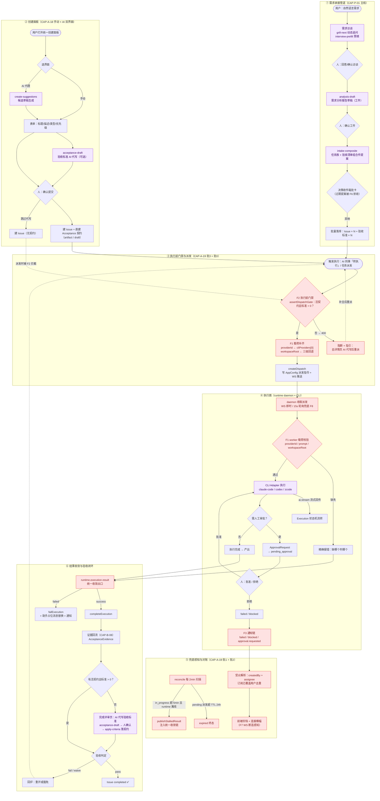
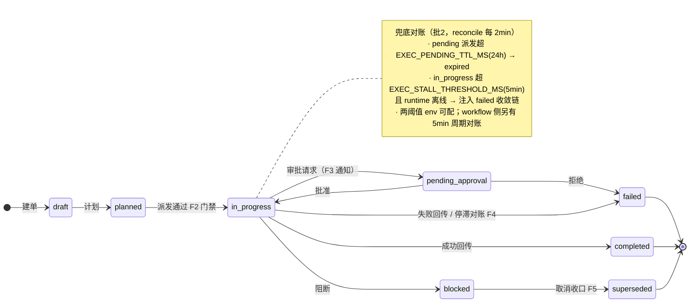

# 全流程节点图 × AI 介入点 × 兜底策略

> 口径基准：develop + PR #52（feat/execution-fallback，CAP-A-19 兜底四批）+ feat/create-dual-panel（CAP-A-18 双界面，未合并）。
> 图例：🟣 紫节点 = AI 介入点；🔴 红节点 = 兜底策略（F1~F8）；🔵 蓝节点 = 人工决策点。

## 一、全流程主节点图

## 二、Execution 状态机与兜底触发点

## 三、AI 介入点清单

| # | 环节 | 场景 / 机制（assistant-silent） | 人的角色 |
|---|------|-------------------------------|---------|
| A1 | 需求访谈 | `grill-next` 动态追问 · `interview-prefill` 预填 · `interview-dynamic` 追问 | 回答追问 |
| A2 | 需求分析 | `analysis-draft` 分析报告草稿（intake 弹窗） | 确认工件 |
| A3 | 拆解落库 | `intake-composite` 任务族+验收清单组合件 → 决策收件箱批卡 | 一次批卡落库 |
| A4 | 建单辅助 | 创建面板 AI 代理界面 + `create-suggestions` 候选 | 选候选微调 |
| A5 | 验收代写 | `acceptance-draft` 三入口：创建面板 / 完成评审页 / 详情页 → 人确认 → `apply-criteria` | 确认标准 |
| A6 | 执行主体 | AI 同事（Member platform_ai_member）经 CLI adapter 亲手写代码 | 只在审批闸门出手 |
| A7 | 对话转执行 | assistant `dispatchExecution` 消息转执行单 | 发起对话 |

## 四、兜底策略清单（CAP-A-19 四批 + 既有）

| 编号 | 名称 | 触发条件 | 动作 | 出处 |
|------|------|---------|------|------|
| F1 | 载荷缺失防呆 | providerId / prompt / workspaceRoot 缺失 | 派发前补齐（`cliProviders[0]` + 工作区三级回退）；worker 报错精确到缺哪个 | 批0（本分支起点修复） |
| F2 | 执行前门禁 | 无活验收契约或 criteria = 0 | 400 阻断 + AI 代写指引（严格要求，已裁决） | 批3 |
| F3 | 失败/阻断通知 | ExecutionRunUpdated(failed/blocked)、ApprovalRequested | 定向通知 createdBy + assignee；`NOTIFY_EXECUTION_AUDIENCE` 可切 project；订阅去重 | 批1 |
| F4 | 悬挂对账 | reconcile 2min：pending > 24h TTL；停滞 > 5min 且 runtime 离线 | pending → expired；停滞 → failed 注入统一收敛链 | 批2 |
| F5 | 状态收口 | cancel blocked 态；run 端点越权 | blocked → superseded 终态；五个 run 端点归属校验 | 批2 |
| F6 | 提案过期 | DecisionProposal expiresAt < now | resolve 拒收；收件箱查询过滤过期 | 批4 |
| F7 | 连接感知 | WS 断连 / 错误 | connection-banner 前端横幅 | 批1 |
| F8 | 派达兜底 | WS 推送丢失 | daemon 15s 轮询 AppConfig 派发指令 | 既有机制 |

## 五、分支状态注记

- CAP-A-19 兜底四批：PR #52（feat/execution-fallback → develop，2026-09-16 提交，gate 七关全绿）。
- CAP-A-18 双界面创建面板：feat/create-dual-panel 六批已提交未合并；图中②层按该分支口径绘制。
- 其余节点均为 develop 现状。
