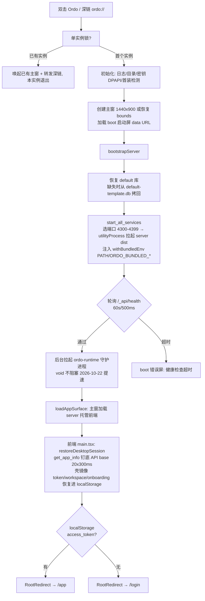
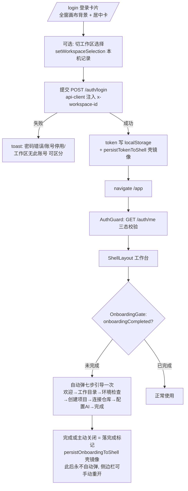
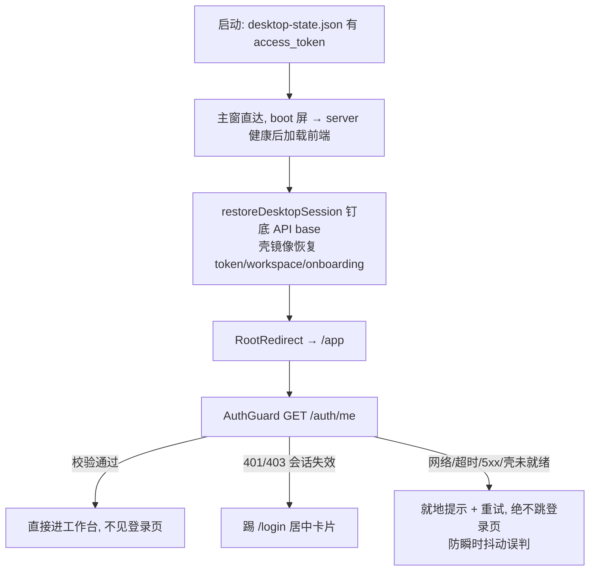
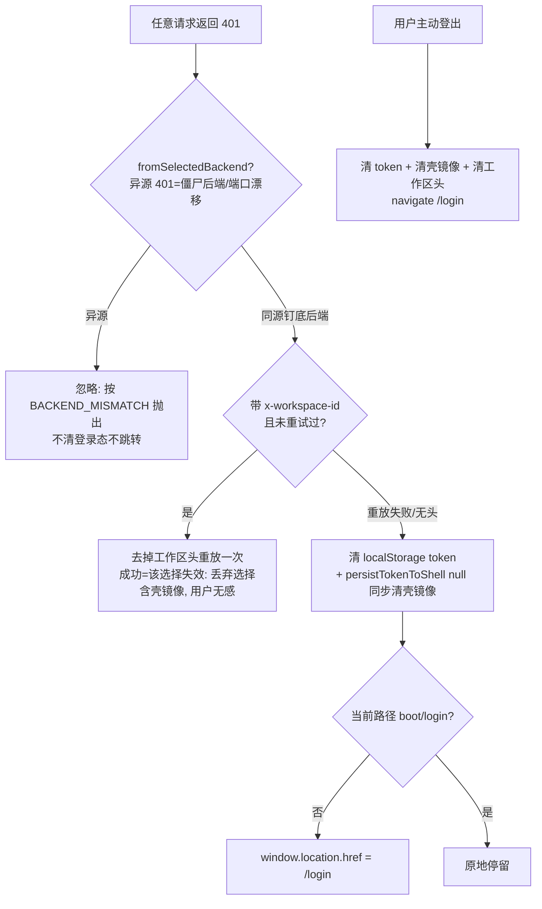

# 桌面端登录·引导·主窗全链路梳理（2026-10-22）

> 背景：用户实测 0.8.0-beta 测试包后报告「大小窗口功能引发一系列 bug」，裁决**恢复全部大窗口，登录功能作为卡片显示在大窗口中间**（修复批 `fix/desktop-window-restore-perf`）。本文档 = 修复后的全链路流程图（现状口径）+ 逐环节逻辑检查结论。

## 一、修复内容（本批落地）

| # | 修复 | 位置 |
|---|------|------|
| 1 | 双窗编排退役：恒以主窗（1440×900 或恢复上次 bounds）启动，不再按登录态切认证小窗 | `apps/desktop/electron/src/main.ts`（createWindow） |
| 2 | 认证窗/切窗/防抖/主窗工厂全部移除；`set_compact_mode` 保留为幂等 no-op（协议兼容） | `apps/desktop/electron/src/windows.ts`、`commands.ts` |
| 3 | `useDesktopCompactWindow` 钩子删除，三处消费方（AuthShell/AuthVisualCard/BootPage）摘除 | `apps/frontend/src/modules/desktop`、`auth`、`boot` |
| 4 | 登录/注册页改版：双表面画布铺满全窗为背景，表单承载在**窗口正中的玻璃拟态卡片**，右上角翻转/主题钮 | `auth-visual-card.tsx` |
| 5 | 帮助弹窗过时文案修正（「端口处于 3000」→ 实际 `/_api`、4300–4399；引导到注册） | `auth-visual-card.tsx` |

## 二、全链路流程图（修复后现状）

### 2.1 冷启动（壳视角）

### 2.2 首次登录流（新用户）

### 2.3 后续登录流（老用户回访）

### 2.4 会话失效与登出

### 2.5 关键防线清单（为什么不会再互踢）

| 防线 | 位置 | 作用 |
|------|------|------|
| API base 钉底 | `restoreDesktopSession → pinDesktopApiBase` | 防请求打到 4300 默认端口的僵尸后端被判 401 |
| 异源 401 忽略 | api-client 响应拦截器 | 端口漂移窗口期不误清会话 |
| AuthGuard 三态 | `auth-guard.tsx` | 网络抖动不等于未登录，不踢登录页 |
| 单窗编排 | 本次修复 | 认证面不再切窗：闪窗/互踢/初始化重跑/大窗残留四类 bug 连根移除 |

## 三、逻辑检查结论（逐环节核对）

### 3.1 已修复（本批）

1. **双窗编排整体退役**（根因修复）。旧机制的四类实机 bug 及其机理：
   - 登录后自动弹认证窗：boot 页/认证面 compact 钩子 false→true 连发 + 主窗落根路径重跑 boot；
   - 窗口互踢死循环：401 误判（陈旧后端）→ 踢登录页 → 挂钩子切小窗 → 反复；
   - 初始化重跑：认证窗↔主窗各自加载前端，boot 序列跑两遍；
   - 大窗残留登录页：壳侧 token 镜像与前端会话不同步时主窗不隐藏。
2. **帮助弹窗过时文案**：「端口处于 3000」与实际（动态端口 4300–4399、`/_api` 前缀）不符，且「admin 首次安装请跑数据库迁移」与现状（模板库+自动补种+注册流）不符 → 已改为准确指引。

### 3.2 核对为正确的设计（非 bug，记录防误报）

| 环节 | 结论 |
|------|------|
| RootRedirect 只查 localStorage 不验后端 | 有意分层：AuthGuard 负责「验」，RootRedirect 只负责「分流」。失效 token 会多一次 `/auth/me` 请求后被踢回，属可接受代价，换来了启动零阻塞 |
| OnboardingGate「关闭即视为已消费」 | 2026-10-03 改版裁决：一台机器主动触及一次，防每次打开都重弹（桌面端完成标记跨 origin 镜像 + restoreDesktopSession 播种回 store） |
| 401 只在同源钉底后端时清会话 | 防僵尸后端/端口漂移误判，重放去工作区头自愈在前 |
| 桌面首启无会话直接进 /login（不再进小窗） | 壳恒主窗，前端 RootRedirect 自然分流 |
| 深链 ordo:// 转发 activeWindow | 单窗下恒主窗，原「认证窗期间转发认证窗」分支随双窗退役 |

### 3.3 遗留观察项（不阻塞，记录待后续批）

1. **boot 屏与前端加载的空白窗口期**：server 健康（实测 8s~31s，见性能诊断文档）后才加载前端，用户在启动屏等待。属启动性能问题而非逻辑错误，优化项见《安装与启动性能诊断-2026-10-22.md》。
2. **AuthGuard isLoading 态是裸文本 "Loading..."**：无骨架屏，弱网下观感差（体验项，非逻辑错误）。
3. **注册页/欢迎页未做居中卡片改版**：欢迎页沿用 AuthShell 分栏壳（大窗下左文右图自然铺开，形态成立）；若用户希望欢迎页也卡片化，属后续视觉批。

## 四、验证口径（实机验收用）

1. 全新安装（清空 ~/.ordo）→ 启动恒为大窗，boot 屏在大窗内呈现 → 登录页为大窗居中卡片；
2. 登录成功 → 直接落工作台（无闪窗、无第二窗口、无重复 boot）→ 七步引导自动弹出一次；
3. 关闭引导重开应用 → 不再自动弹；侧边栏「引导」可手动重开；
4. 登出 → 回登录卡片（大窗内）；重启应用 → 免登录直达工作台；
5. 手动把后端进程杀掉再启动应用 → boot 屏走「健康检查」直至恢复或显式报错，不出现窗口互踢。
